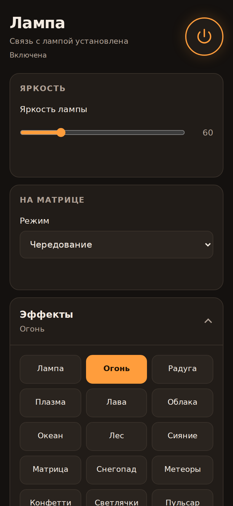
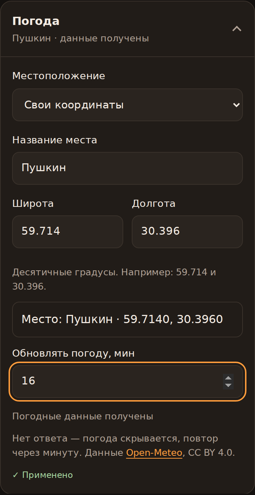
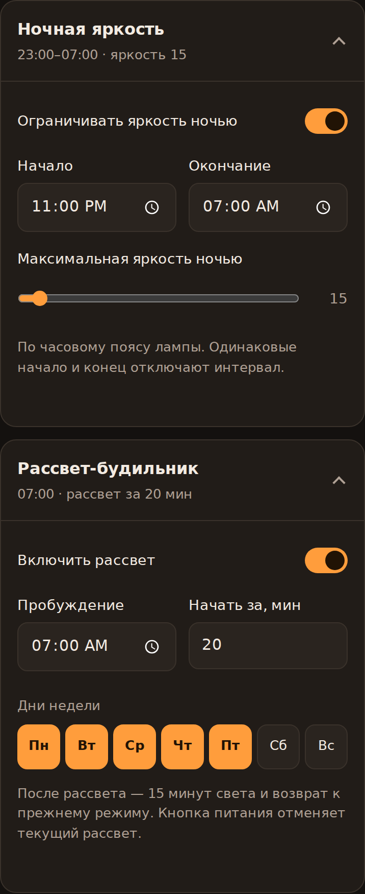
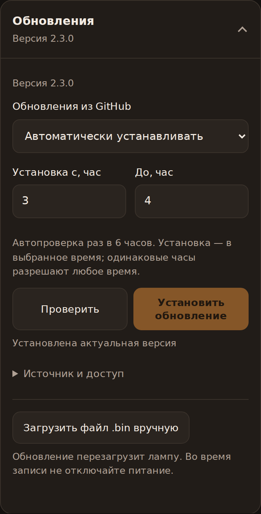
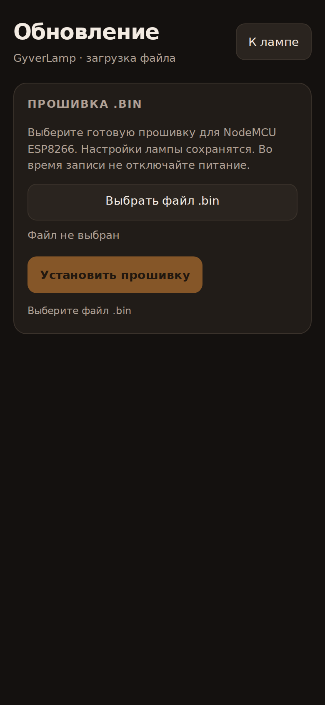

# GyverLamp — готовые прошивки 2.3.0

Лампа NodeMCU ESP8266 + WS2812B 16×16: управление по Wi-Fi, эффекты, часы, погода, рассвет и обновления. Этот **публичный репозиторий содержит только готовые прошивки, документацию и скриншоты**. Исходники проекта находятся в отдельном приватном репозитории.

**[Скачать GyverLamp 2.3.0 BIN](firmware/GyverLamp-2.3.0.bin)** · [Манифест latest.json](latest.json)

| Совместимость | Значение |
|---|---|
| Плата | NodeMCU ESP8266, Flash 4 MB / FS 2 MB |
| Матрица | WS2812B, 16×16, D4 / GPIO2, GRB, 800 кГц, змейка |
| Предел матрицы в готовом BIN | 2000 мА, программная оценка; не включает ESP8266 |
| Сеть лампы | `GyverLamp`, пароль `12345678` |
| Страница | http://192.168.4.1 или локальный IP от домашнего роутера |

## Возможности

| Функция | Поведение |
|---|---|
| 15 эффектов | Лампа, Огонь, Радуга, Плазма, Лава, Облака, Океан, Лес, Сияние, Матрица, Снегопад, Метеоры, Конфетти, Светлячки, Пульсар |
| Настройки | Яркость, цвет лампы, отдельные скорость и масштаб эффектов, таймер выключения |
| Избранное | Выбор эффектов и автосмена через 5–3600 с |
| Плавные переходы | Смешивание изображений за 700 мс |
| Часы | NTP; часы сверху, минуты снизу; ручной выбор смещения UTC |
| Погода | Поиск города с выбором региона и страны; крупный значок и отдельный экран температуры |
| Погодная атмосфера | Тёплый свет, облака, синие капли или крупные снежинки по погоде |
| Рассвет | Дни недели, время пробуждения, разгорание за 5–60 минут и 15 минут света после него |
| Ночная яркость | Предел яркости по расписанию, включая интервал через полночь |
| Песочные часы | 1–180 минут; зелёное свечение в конце и возврат к прежнему режиму |
| Уведомления | Временное цветовое свечение на 1–60 с через HTTP, например из n8n/NAS |
| Обновления | Ручная загрузка BIN, проверка GitHub по кнопке, автопроверка или ночная автоустановка |

## Интерфейс

Скриншоты получены из **HTML текущей версии 2.3.0** в Chromium с мобильной шириной 390 px. Сеть, время и погода на них заданы демонстрационными ответами API; это не снимки работающей физической лампы. Реальные ключи и пароли не показаны.

| Управление эффектами | Настройки погоды |
|---|---|
|  |  |

| Расписания и избранное | Обновления из GitHub |
|---|---|
|  |  |

## Настройки без кнопок «Сохранить»

Каждая функция находится в отдельном сворачиваемом блоке. Изменения применяются автоматически: «Применяю…» до ответа, зелёная галочка «Применено» после подтверждения устройством. Ошибка сохранения показывается отдельно с повторной попыткой.

Wi-Fi применяется после завершения редактирования названия сети и пароля; новый пароль обновления — после завершения ввода. Для паролей есть «Показать / Скрыть». Погоду можно настроить поиском города либо своими координатами и названием места; интервал обновления — 5–120 минут.



## Особенность вывода матрицы

На нашей лампе прежняя прошивка с выводом FastLED работала некорректно. Тест Adafruit NeoPixel зажёг все 256 светодиодов на том же D4 / GPIO2. После замены основного вывода на NeoPixel пользователь подтвердил работу лампы. Точная причина прежнего сбоя не установлена: это результат для конкретной сборки, а не доказательство общей несовместимости FastLED. Работа на малой яркости не подтверждает достаточность питания на полной нагрузке.

В версии 2.3.0 **FastLED рассчитывает эффекты**, а **Adafruit NeoPixel передаёт цвета в матрицу**. FastLED.show() не используется. Яркость применяется один раз, ограничитель тока учитывает итоговое изображение и переходы. При прошивке готового BIN библиотеки устанавливать не требуется.

USB-драйвер CH340/CP210x отвечает за порт компьютера, а не за работу матрицы. Если прошивка успешно записывается, замена USB-драйвера не является заменой светодиодной библиотеки.

## Первая установка

Если старая прошивка не поддерживает обновление через веб-страницу, загрузите BIN по USB с адреса `0x0`, используя фактический COM-порт:

```sh
esptool.py --port COM3 --baud 115200 write_flash 0x0 GyverLamp-2.3.0.bin
```

На время USB-прошивки отключите внешние +5 В от VIN, чтобы не соединять два источника питания через плату. Если загрузке мешает обесточенная матрица, отключите D4 → DIN: GPIO2 должен иметь правильный высокий уровень при старте. При возврате проводов отключайте питание. При автономной работе питание матрицы и платы должно иметь общую землю.

Готовый BIN рассчитан на внешнее подходящее питание, а не на питание всей матрицы через USB платы. Программный CURRENT_LIMIT не измеряет ток и не заменяет аппаратную защиту. Потребление контроллера и потери преобразователя не учтены в пределе матрицы.

После запуска подключитесь к Wi-Fi `GyverLamp`, откройте http://192.168.4.1, задайте домашний Wi-Fi 2,4 ГГц. После NTP выберите город и часовой пояс (Москва/Санкт-Петербург: +3). Роутер выдаст лампе локальный IP; собственная сеть GyverLamp останется доступной.

## Обновления без USB

### Ручная загрузка файла

Откройте «Обновления → Загрузить файл .bin вручную». Логин — **admin**; индивидуальный пароль доступен через «Источник и доступ → Показать». Выберите BIN и нажмите **«Установить прошивку»**. Страница показывает ход загрузки и результат; после успешной записи лампа перезагрузится. Питание во время записи не отключать. В старой версии 2.1/2.2 на странице обновления выбирайте поле Firmware, не FileSystem.

Если установленная прошивка ещё не поддерживает веб-обновление, новую версию сначала загружают через USB. Версию 2.1 можно обновить до 2.3.0 вручную через веб-страницу.

### Из GitHub

Публичное хранилище **[boklagvladimir-dev/gyverlamp-firmware](https://github.com/boklagvladimir-dev/gyverlamp-firmware)** уже опубликовано: содержит готовый BIN 2.3.0 и `latest.json`. Исходники остаются приватными.

| Режим | Проверка | Установка |
|---|---|---|
| Вручную | По кнопке | По кнопке |
| Проверять автоматически | Раз в 6 часов | По кнопке |
| Устанавливать автоматически | Раз в 6 часов | В заданные часы, по умолчанию 03:00–04:00 |

Часы окна установки — в часовом поясе лампы; одинаковые часы разрешают любое время. Во время рассвета, таймера или уведомления задача ожидает. После ошибки повторная автопроверка через час. По умолчанию выбран ручной режим.

Лампа устанавливает только **более новую** версию. Если уже стоит 2.3.0 и опубликована 2.3.0, сообщение «Установлена актуальная версия» является правильным результатом.

Обновление скачивается по HTTPS во временный файл LittleFS. До записи проверяются схема манифеста, версия, плата `nodemcuv2-4m2m`, размер и **SHA-256**. Ошибка загрузки или хеша отменяет установку. SHA-256 проверяет целостность; отдельной подписи манифеста нет, доверие основано на HTTPS и доступе к репозиторию.

**GitHub-токен в версии 2.3.0 не поддерживается и не требуется**: источник должен быть публичным. Пароль веб-обновления — пароль лампы, а не GitHub-токен. Прямое скачивание из приватного репозитория было бы отдельной реализацией.

## Часы, погода и отсутствие интернета

Часы получают UTC через NTP; после синхронизации продолжают идти до отключения питания. После перезапуска скрыты до синхронизации. Часовой пояс задаётся вручную, без автоматического летнего времени. Передачи времени с телефона нет.

Погода Open-Meteo — модельные данные (CC BY 4.0; бесплатный API для некоммерческого использования). Обычное обновление по умолчанию раз в 15 минут; интервал настраивается от 5 до 120 минут. При потере Wi-Fi или ошибке ответа **погода и температура скрываются**; повторный запрос после ошибки через минуту. Во время рассвета, таймера и уведомления запросы отложены. Недоступный информационный экран заменяется эффектом.

## Уведомления и доступ

HTTP POST на `http://IP_ЛАМПЫ/notify`, заголовок `X-Lamp-Key` из интерфейса, тело form-urlencoded `color=00ff00&seconds=5`. Ключи не зашиты в опубликованный BIN: создаются при запуске и сохраняются на конкретной лампе.

Основной интерфейс рассчитан на доверенную локальную сеть и не требует входа. Не открывайте порт лампы в интернет. Раздел дополнительных настроек возвращает локальный пароль обновления и ключ уведомлений; не публикуйте эти ответы.

## Файлы и проверка

- `firmware/GyverLamp-2.3.0.bin` — версия с совместимостью `nodemcuv2-4m2m`.
- `latest.json` — версия, тип платы, размер, URL, SHA-256 и описание выпуска.
- `docs/web-ui*.png` — текущий интерфейс с демонстрационными данными.

Проверены сборка 2.3.0, логика расписаний/версий, запросы интерфейса и анонимное скачивание опубликованного BIN с совпадением SHA-256 и размера (568160 байт). На физической лампе подтверждён вывод NeoPixel; полная проверка функций 2.3.0 и OTA на устройстве ещё требуется.

При публикации следующих выпусков сначала загрузите версионный BIN, затем обновите latest.json. Сохраняйте старые BIN доступными по прежним адресам. Обновление не требует GitHub Releases и GitHub Actions.

### Проверка интерфейса 2.3.0

Проверены размеры экрана 320–768 px, формы с раскрытыми настройками, автоматические частичные запросы, быстрый повторный ввод, ошибка записи и повтор, поиск города/свои координаты, показ пароля, отложенное применение Wi-Fi и смена пароля обновления. При изменении одной функции остальные настройки не перезаписываются. Проверена обработка ошибки ручной загрузки BIN на тестовом сервере. Сквозная запись OTA на физической лампе остаётся отдельной аппаратной проверкой.
